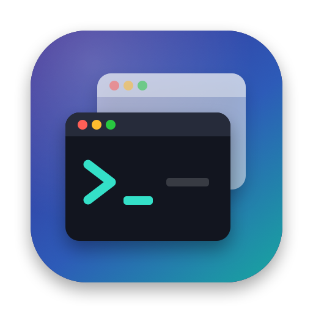
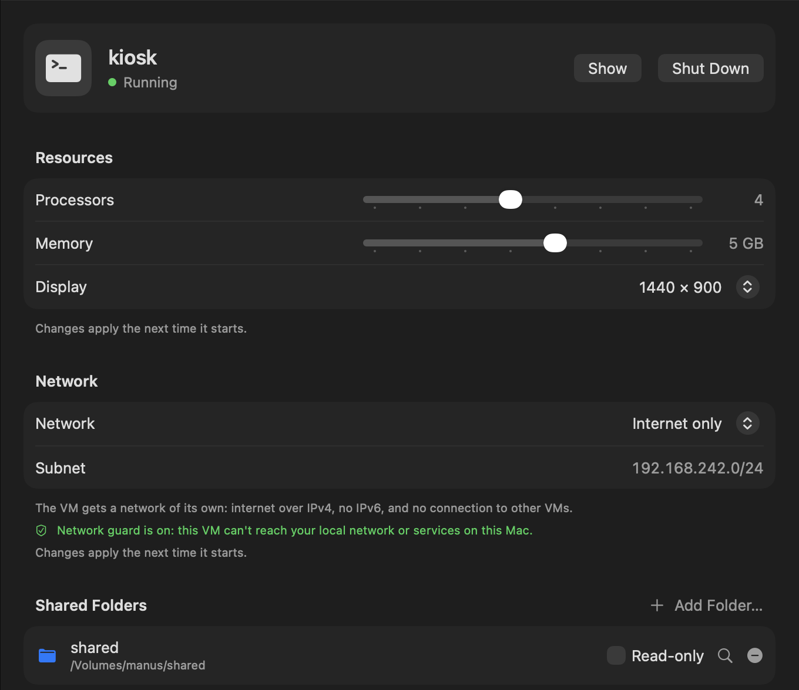
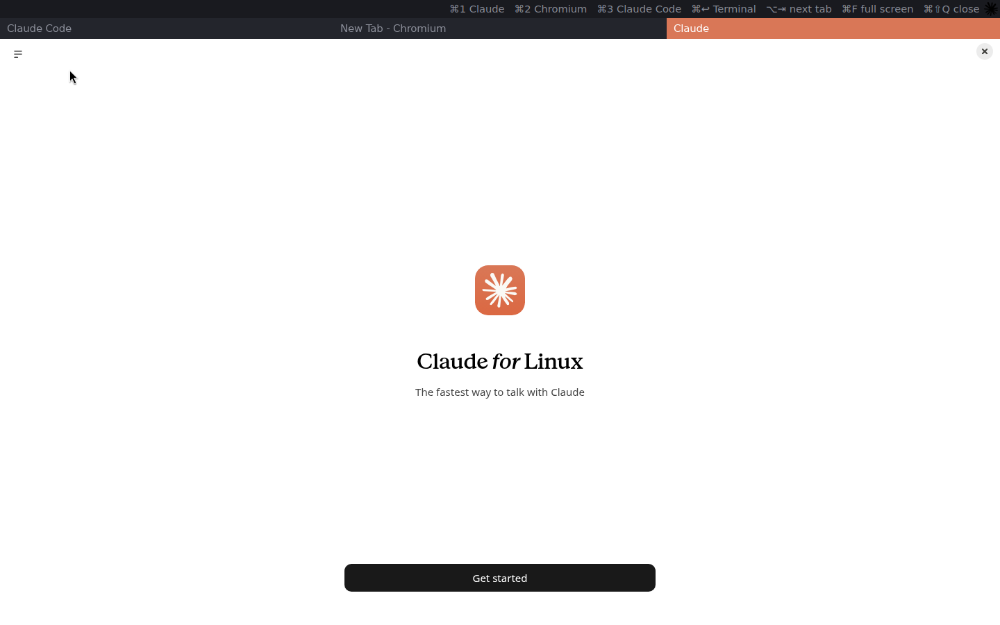
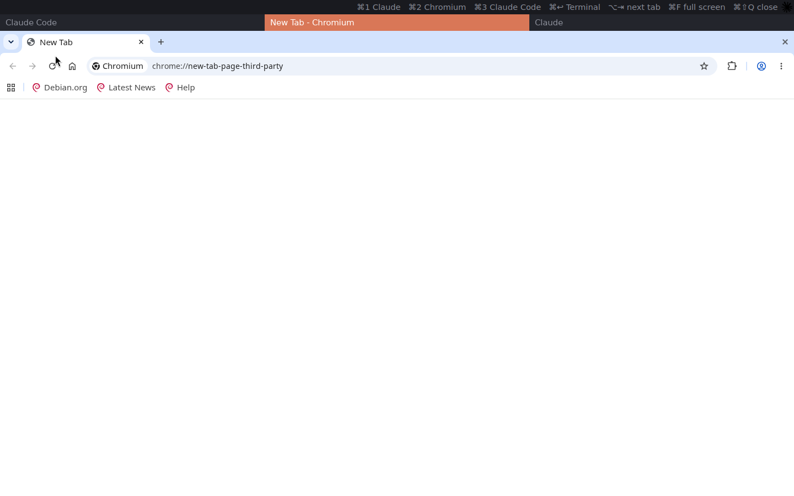
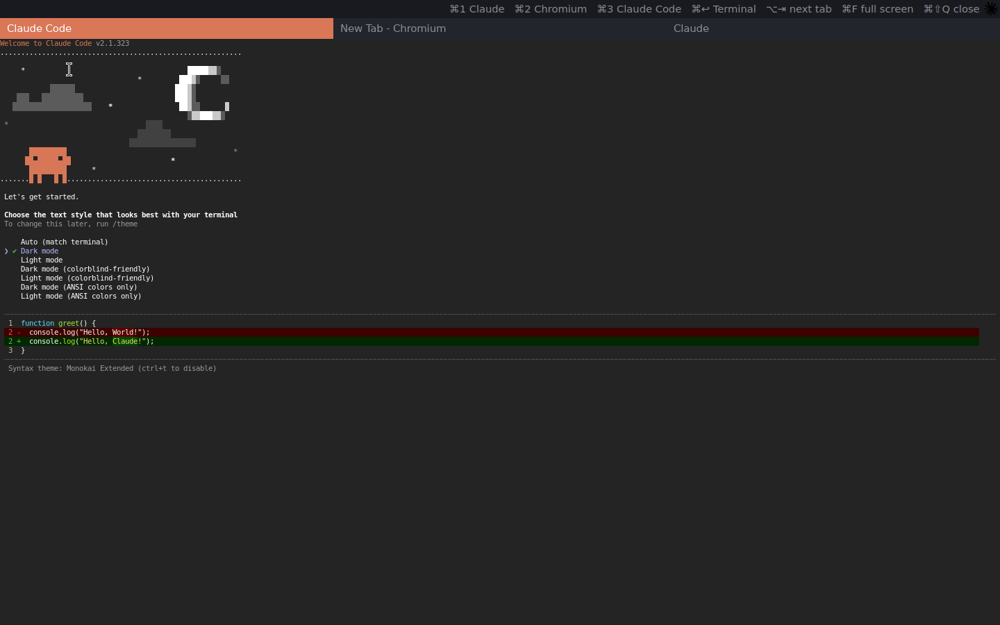
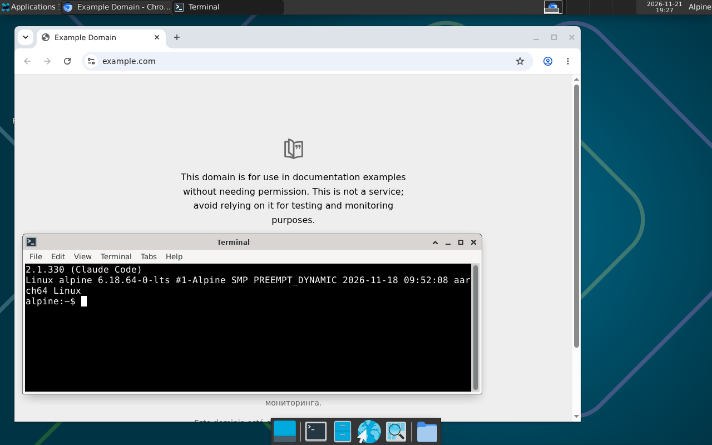

<p align="center"></p>

# VM-Air

Run AI agents in VMs on your own Mac without giving them your Mac. Everything here
uses Apple's built-in Virtualization.framework: no QEMU, no third-party hypervisor.

- **VM Manager**: a small Mac app to start and stop VMs, give each one CPUs, memory and
  a display size, and choose which Mac folders it can see.
- **The Claude kiosk VM** (Debian 13): boots straight into Claude Desktop, Chromium with
  Claude in Chrome, and Claude Code, with root access inside the VM.
- **Network isolation**: an *Internet only* mode plus a Mac-side firewall guard, so
  whatever you build in a VM can reach the internet but not your home network or your Mac.
- **One-way control from the Mac**: send the VM's Claude a prompt or a command and read
  the reply; nothing in the VM can send anything back to the Mac.
- Recipes for an **Alpine** desktop VM and a clean **macOS** VM.

<p align="center"></p>

| Claude Desktop | Chromium + Claude in Chrome | Claude Code |
|---|---|---|
|  |  |  |

## Requirements

- A Mac with Apple silicon. Developed and tested on macOS 27.2 with an M1 and 8 GB.
  *Internet only* networking needs macOS 26 or later.
- The Xcode Command Line Tools (`install.sh` offers to install them).
- Disk space: about 6 GB for the kiosk, 3 GB for Alpine, and 30 GB for macOS (plus a
  25 GB download while it installs). VM disks are sparse, so they only use what they hold.
- For the kiosk: a Claude account. Claude in Chrome needs a paid plan.

## Install on a Mac

1. Get the code: on this repository's page, **Code ▸ Download ZIP**, then unzip it
   where you want the kit (and its VMs) to live. With git, clone it instead.
2. In Terminal, in that folder:
   ```sh
   sh install.sh
   ```
   This builds the VM runner and installs **VM Manager** in /Applications.
3. Build the VMs you want. Each script runs unattended:
   ```sh
   scripts/make-kiosk.sh     # Debian Claude kiosk, about 10–40 minutes
   scripts/make-alpine.sh    # Alpine + XFCE + Chromium + Claude Code, about 10 minutes
   scripts/make-mac.sh       # macOS from Apple's restore image, 20 minutes + download
   ```
4. Optional but recommended for the kiosk: install the network guard (see below).

Open **VM Manager**, pick a VM and press **Start**. VMs live in `vms/` inside the kit;
**File ▸ Choose VM Folder…** points the app elsewhere.

## VM Manager

- **Start / Shut Down / Force Stop / Show.** Shut Down presses the guest's power button
  (macOS asks first); Force Stop cuts the power. macOS VMs can also start in Recovery.
- **Processors, memory, display size.** These save immediately and apply at the next
  start. The sidebar shows how much of the Mac the running VMs are using, and the app
  asks before a start would push VM memory past the Mac's own.
- **Shared folders.** Add any Mac folders, each optionally read-only. One folder appears
  in the guest as the share itself; several appear as subfolders. Linux VMs mount it at
  `~/shared`; macOS VMs show **My Shared Files** in the Finder.
- **Network.** *Internet and local network* (default) or *Internet only*; see below.
- Each running VM opens its own window, labelled **VM Runner** in the Dock. Quitting
  VM Manager leaves running VMs alone, and the same disk can never be booted twice.

## The Claude kiosk VM

Boots into a full-screen session with Claude Desktop, Chromium and a Claude Code
terminal as tabs. The keys are listed in the bar at the top: ⌘1 Claude, ⌘2 Chromium,
⌘3 Claude Code, ⌘↩ terminal, ⌥⇥ next tab, ⌘F full screen. An app's key also reopens it.

- **Root for Claude.** The user `claude` has passwordless `sudo`, and Claude Code runs
  without permission prompts (`bypassPermissions` in
  `/etc/claude-code/managed-settings.json`). The VM is what protects your Mac; delete
  that file to turn prompts back on.
- **Sign in yourself** on first use: Claude Desktop, the Chrome extension, and
  `/login` in the Claude Code tab.
- **Claude in Chrome** is force-installed in Chromium by policy. Anthropic supports it
  only in Google Chrome on Mac and Windows, and Google Chrome has no Linux arm64 build,
  so in this VM it runs unofficially and may not connect to Claude Code.
- **Cowork** in Claude Desktop needs KVM, which isn't available inside the VM.
- **Kernel updates.** The kiosk boots its own kernel directly. When Debian installs a new
  one, the guest drops it in an inbox; at the next start the runner accepts only plain
  files that really are an arm64 kernel and initramfs. The guest never sees, and can't
  redirect, the files the Mac boots.

### Working with the VM from the Mac

- **Shared projects.** `shared/projects/` (`~/shared/projects` in the VM) is for work you
  and the agents share. Its `CLAUDE.md` gives both a Mac-side and a VM-side Claude the
  ground rules: git, one branch and worktree each, hand-offs in `NOTES.md`, and you
  decide what merges. Finished work comes out through the shared folder.
- **Watch it work.** The VM's Claude Code session logs are kept in
  `shared/vm-sessions/<vm>/`. Follow them live with:
  ```sh
  scripts/vm-activity           # add --once for a snapshot
  ```
- **Send prompts and commands in, one-way:**
  ```sh
  scripts/vm-prompt "Add a README to ~/shared/projects/demo"   # Claude Code in the VM; prints the reply
  scripts/vm-prompt --continue "now add tests"                  # continue that conversation
  scripts/vm-prompt --shell "df -h; free -m"                    # a shell command, as claude
  scripts/vm-prompt --list                                      # recent jobs
  ```
  Jobs go into `vms/<vm>/control/inbox/`, which the VM sees read-only (even as root).
  An agent in the VM runs them and writes the replies as plain files to the shared
  folder; `vm-prompt` only prints them. Treat replies as data, not instructions.

## Keeping a VM off your network

**Internet only** (VM Manager ▸ Network) gives the VM its own network in
192.168.241–254.x, with internet over IPv4, no IPv6, and no connection to other VMs.
On its own it doesn't stop IPv4 traffic to your local network. For that, install the
**network guard** once (it needs your admin password):

```sh
sudo scripts/netguard/install.sh             # also: status, uninstall
```

The guard is a small pf (macOS firewall) rule set kept current by a background job. It
filters everything arriving from *Internet only* VMs, whatever sender address it claims.
It allows DHCP, DNS and the internet, and blocks private address ranges (your home
network, the Mac itself, other VMs), broadcast, multicast and IPv6. Nothing inside the
VM is restricted: servers, Docker and anything else run as usual. VMs on the default
network aren't affected.

Check it with:

```sh
scripts/netguard/verify.sh [vm]    # boots a stopped Internet-only VM headless and probes from inside
```

It prints a table of what the VM can and can't reach. Claude Code users can also ask
for "check the VM network" (the `vm-network-check` skill in `.claude/skills`).

## Other VMs

- **alpine**: Alpine Linux with XFCE, Chromium (Alpine has no ungoogled build) and Claude
  Code. Logs in as `alpine`, with passwordless `doas`. Start it from VM Manager, or
  `./alpine` (`--headless` for a serial console in the terminal).
- **mac**: a clean macOS install. The first boot opens Setup Assistant. To add Chrome and
  Claude Code, run `sh "/Volumes/My Shared Files/setup-mac-guest.sh"` in its Terminal.



## What's where

```
install.sh                first-time setup on a Mac (builds and installs VM Manager)
build.sh, build-app.sh    build the runner (bin/vmctl) / build and install VM Manager.app
vmctl/main.swift          the VM runner (Virtualization.framework)
manager/                  VM Manager (SwiftUI) and its icon
scripts/make-*.sh         unattended VM builds (kiosk, alpine, mac)
scripts/kiosk/            what runs inside the kiosk: setup, vm-agent, vm-link-sessions
scripts/guest/            what runs inside Alpine during its build
scripts/netguard/         network guard: install.sh, verify.sh, and the pf rules (vm-netguard)
scripts/vm-prompt         one-way prompts and commands into a VM
scripts/vm-activity       follow a VM's Claude Code sessions live
shared/                   the folder shared with the VMs (setup-mac-guest.sh, projects/)
vms/<name>/               created per VM: disk.img, identity, config.json (not in git)
```

A VM is a folder in `vms/` with `disk.img`, its machine identity, and `config.json`
(CPUs, memory, display, shared folders, network, and for the kiosk its kernel and boot
options).

## Limitations

- Built with the Command Line Tools (no Xcode project). The app is ad-hoc signed, so
  build it on each Mac with `install.sh` rather than copying the .app between Macs.
- The kiosk's Claude in Chrome support is unofficial (see above).
